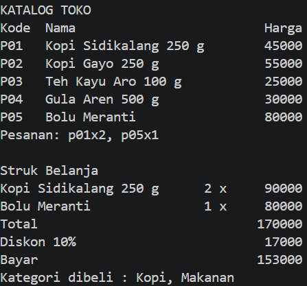
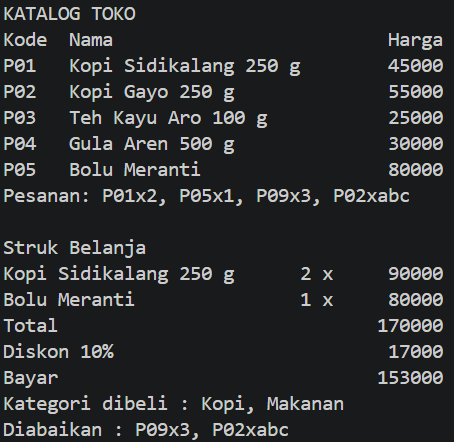

# Tugas Rutin 2 Pemrograman Mobile - Pertemuan 02

## Identitas

- **Nama:** Sebastian Saut Marulitua Sinaga
- **NIM:** 4242550005
- **Kelas:** PSIK 24D
- **Dosen:** Adidtya Perdana, S.T., M.Kom

## Deskripsi

Program console Dart untuk kasir sederhana sebuah toko oleh-oleh di Medan.
Program menampilkan katalog produk, menerima pesanan dalam satu baris
lalu mencetak struk belanja. Kode produk yang tidak ada atau jumlah yang 
tidak valid tidak membuat program berhenti, tetapi dicatat sebagai item yang 
diabaikan. Total belanja minimal Rp100.000 mendapat diskon 10%.

## Skenario 1: Pesanan Valid

Input: `P01x2, P05x1`

## Skenario 2: Pesanan dengan Kode Salah

Input: `P01x2, P05x1, P09x3, P02xabc`

## Penjelasan

`var`, `final`, dan `const` sama-sama dipakai untuk membuat variabel, tetapi
aturannya berbeda. `var` membuat variabel yang nilainya boleh diubah.
`final` hanya boleh diisi sekali, dan nilainya ditentukan saat program
berjalan. `const` juga hanya diisi sekali, tetapi nilainya harus sudah pasti
sejak kompilasi. Di program ini saya memakai `const` untuk `batasDiskon` dan
`persenDiskon` (baris [X-Y]) karena nilainya tetap, dan `final` untuk `input`
(baris [Z]) karena nilainya baru diketahui setelah pengguna mengetik. `var`
hanya dipakai pada variabel `i` di perulangan karena nilainya berubah.

Null safety mencegah crash karena Dart membedakan tipe yang boleh null
(diberi tanda `?`) dan yang tidak. Pada baris [A], `katalog[kode]` bertipe
`Produk?` karena kode yang diketik pengguna bisa saja tidak ada di katalog.
Begitu juga `int.tryParse` pada baris [B] yang menghasilkan `int?` jika teks
bukan angka. Pada baris [C], saya mengecek `produk == null || qty == null`
sebelum nilainya dipakai, sehingga item yang salah dicatat sebagai ditolak
dan program tidak berhenti. Setelah pengecekan itu, Dart menganggap `produk`
dan `qty` pasti tidak null, jadi operator `!` tidak diperlukan.

## Pernyataan Penggunaan AI

Saya menggunakan AI Claude (Anthropic) sebagai bantuan belajar untuk
menjelaskan konsep, memberi contoh kode awal, memeriksa kode, dan membuat kode yang bersih (Clean Code). Kodenya sudah saya pelajari, saya uji sendiri dengan berbagai input, dan saya mampu menjelaskan cara kerjanya.